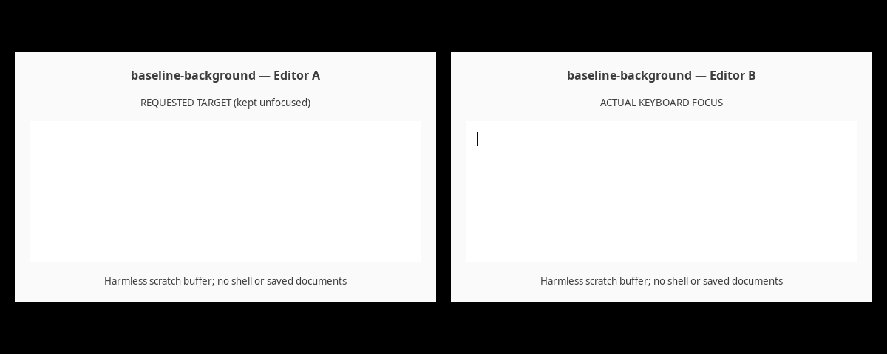

# Linux background input: reproduction and fix

Affected baseline: `897b8e025fb77791a0867b21c9fe9f5a0a47ac4b` (0.3.2).

On Linux, the five synthetic-input methods checked `InputTarget` for Wayland
compatibility, then discarded its app, window and delivery mode. They called
`GenerateKeyboardEvent` / `GenerateMouseEvent` on the AT-SPI device event
controller. Those calls contain no target app or window. On X11, the compatibility
check returned immediately, so both background modes silently emitted global
input and returned success. A newline in `type_text` also emitted Return.

The public enum already documented a possible global fallback. The problem is
that the default mode gave callers no error or accurate delivery result when
Linux could not honor app targeting. A caller could type into an unrelated
focused app. This is a routing/consent issue, not evidence of malicious code.

## Real desktop reproduction through the public API

The stronger repro uses **real GTK editors, real AT-SPI services, and a real X11
server (Xvfb)**, without a mock backend or recording controller. The same Rust
example is built against baseline and patched source in separate Cargo target
directories. It calls `Computer::new`, resolves editor A by exact PID, and calls
`Computer::type_text` targeting A while editor B holds keyboard focus.

```sh
bash scripts/repro-linux-desktop.sh
```

Additional prerequisites: `Xvfb`, Python 3 with PyGObject, GTK 3 introspection,
Pillow, and the normal AT-SPI services. On Debian/Ubuntu these are typically
`xvfb python3-gi gir1.2-gtk-3.0 python3-pil at-spi2-core dbus`. Use system Python
with these packages available. No window manager or existing desktop is needed.

The harness starts its own authenticated Xvfb (`-nolisten tcp`), private D-Bus
session, temporary HOME and runtime directory, and memory-only settings backend.
It passes explicit private display, session-bus and accessibility-bus addresses
to the driver. It enables accessibility only on that private session. It starts
two separate scratch-editor processes per scenario, focuses B with Xlib, and
checks the X server's focus before and after the API call. It stops the fixture
process groups, including D-Bus-activated children, when done.

Each editor independently writes its own **Gtk.TextBuffer** contents to JSON.
Those values, rather than this library's accessibility reader or screenshots,
verify the destination. Screenshots and the GIF are captured from the private
X server through GDK, independently of this library's screenshot implementation.
All input is a harmless ASCII marker, without newlines, commands or shortcuts.

Observed results (all four assertions passed):

| Source | Delivery | API result | Editor A (requested) | Editor B (focused) |
| --- | --- | --- | --- | --- |
| Baseline 0.3.2 | Background | `Ok(())` | Empty | Marker received |
| Patched | Background | `Unsupported` | Empty | Empty |
| Baseline 0.3.2 | Global | `Ok(())` | Empty | Marker received |
| Patched | Global | `Ok(())` | Empty | Marker received |

[Machine-readable results](evidence/linux-desktop/results.json) ·
[public API stdout](evidence/linux-desktop/public-api-output.txt) ·
[editor-owned buffer snapshots](evidence/linux-desktop/buffers)

The 12.4-second recording below contains actual captured frames from all four
scenarios. Each window's heading identifies the scenario and its role.



[Baseline background screenshot](evidence/linux-desktop/baseline-background.png) ·
[Patched background screenshot](evidence/linux-desktop/fixed-background.png) ·
[Baseline global screenshot](evidence/linux-desktop/baseline-global.png) ·
[Patched global screenshot](evidence/linux-desktop/fixed-global.png)

The global cases establish the remaining limitation even with explicit opt-in:
**naming editor A does not make Linux synthetic typing reach A**. The patch
addresses implicit global delivery; it does not repair app targeting in Global.
The existing documented fallback is acknowledged above, rather than treating
background-mode behavior alone as evidence of an undocumented fallback.

## Recording-bus regression reproduction

Prerequisites: Linux, Git, Bash, Rust >= 1.89 and `dbus-daemon` (usually package
`dbus`). Cargo needs the locked dependencies cached or network access to fetch
them. Local Unix sockets must be permitted. No X server or desktop session is
needed.

From this PR's checkout:

```sh
bash scripts/repro-linux-input.sh
```

The script exports the exact unpatched baseline to a temporary directory, copies
in the same regression test, and runs it against baseline and fixed source in
**separate Cargo target directories**. It requires the specific regression
assertion to fail on baseline; a build or bus-startup failure does not count as
reproduction. It prints an evidence directory containing both full logs.

The test starts a new private `dbus-daemon` and serves a recording implementation
of `org.a11y.atspi.DeviceEventController`. It builds `LinuxBackend` directly with
that connection and an empty session environment. It never calls session
discovery, enables accessibility, contacts the desktop accessibility bus, or
sends events to a real X server.

## Observed before and after

Recorded on Linux 7.0.0-43-generic with rustc 1.99.1 and cargo 1.99.1.
The recording-bus test intentionally names a fictitious app, PID 42. No desktop
process or window is required for the affected baseline to return success.

On baseline, all ten calls succeeded (five operations in each background mode),
and the recorder received 46 events. The full assertion output is in
[evidence/linux-input-baseline.txt](evidence/linux-input-baseline.txt). Excerpt:

```text
"Background click: Ok(())",
"Background scroll: Ok(())",
"Background drag: Ok(())",
"Background type_text: Ok(())",
"Background press_key: Ok(())",
"FocusedBackground click: Ok(())",
"FocusedBackground scroll: Ok(())",
"FocusedBackground drag: Ok(())",
"FocusedBackground type_text: Ok(())",
"FocusedBackground press_key: Ok(())",
...
"key 0 \"CU_REPRO_MARKER\" String",
"key 65293 \"\" Sym",
```

65293 (`0xff0d`) is Return. The test text contains a newline, but the recording
service only stores messages; no text is typed and no command is executed.

After the patch, every background call returns `Error::Unsupported` and the
recorder remains empty. The positive-control test explicitly selects
`Delivery::Global` and verifies that its marker reaches the same recorder.

Validation commands:

```sh
cargo fmt --all -- --check
cargo test --locked --all-targets
cargo test --locked --doc
cargo clippy --locked --all-targets -- -D warnings
```

Results: 50 unit tests, 15 fake-backend integration tests, one Send test and
three doctests passed; formatting and Clippy passed. Test and lint output is in
[evidence/linux-input-validation.txt](evidence/linux-input-validation.txt). The before/after script
also passed with its expected baseline failure and two passing fixed tests.

## Scope and compatibility

This patch rejects Linux `Background` and `FocusedBackground` synthetic input
before reaching the controller. Existing callers relying on the implicit global
fallback now receive an error. Accessibility element actions and value-setting
remain available, and callers can explicitly opt into `Delivery::Global`.

Explicit global input retains its existing desktop-wide behavior. It does not
activate or verify the named app, constrain pointer coordinates to its window,
or prevent focus changes. This PR documents that limitation; it does not claim
to implement secure app-scoped global delivery. Targeted editable-text insertion
and verified input routing would be separate improvements.

The recording-bus test establishes event emission and suppression for all five
operations. The real desktop repro additionally demonstrates wrong-app text
insertion through the public API on X11, and confirms both the background fix
and remaining global limitation. It does not establish privilege escalation or
a bypass of native Wayland restrictions. Other review findings (accessibility
settings, session discovery, password redaction, screenshot fallback) are
outside this focused PR.
